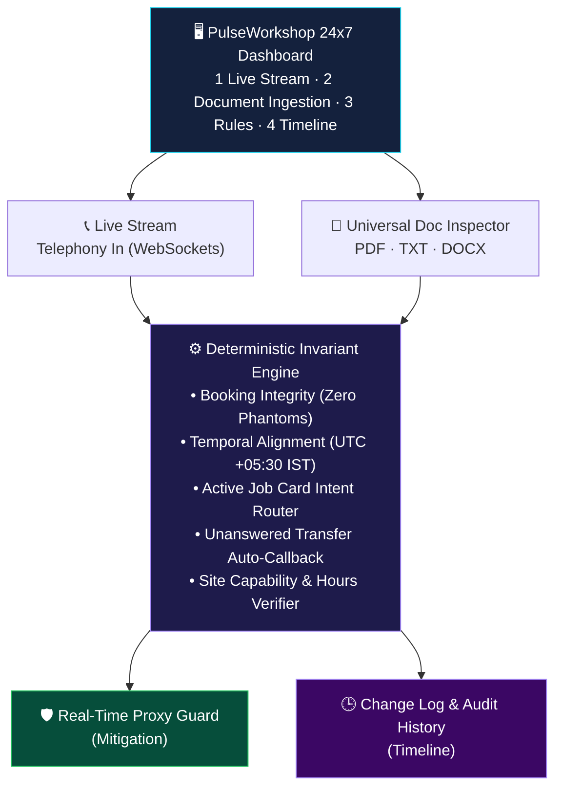

<div align="center">


<a href="https://github.com/DenverCoder1/readme-typing-svg">
  
</a>

<br/>


**Candidate:** Prateek &nbsp;|&nbsp; **Role:** Forward Deployed Engineer (Full Time), Spyne
**Site Under Audit:** Sparsh Motors, Kothrud Workshop (`KTD-04`)

[📄 Submission PDF](Spyne_FDE_Case_Study_Pune_Workshop_Diagnostics.pdf) · [🚀 Quick Start](#-how-to-run-the-platform) · [🧪 Tests](#1-run-automated-test-suites)

</div>

---

## 🏗️ 1. High-Level Enterprise Product Architecture

PulseWorkshop 24x7 is a production-grade automotive service diagnostics and guardrail platform built to run around the clock across multi-site dealership groups (Pune workshops, US retail dealerships).



---

## ✨ 2. Enterprise Feature Capabilities

<details open>
<summary><b>📄 Universal Document Ingestion & Deep Inspection</b></summary>

<br/>

- **Supported formats:** call transcripts, weekly reports and log dumps in **PDF, DOCX, TXT, MD, or JSON**.
- **Automatic ingestion pipeline:**
  1. Extract text from PDF pages (via `pypdf`) or DOCX OpenXML runs.
  2. Parse multi-turn speech transcripts, timestamps, customer metadata and JSON tool execution traces.
  3. Evaluate every extracted call against deterministic operational invariants.
  4. Generate an instant **Discrepancy Matrix**, violation breakdown and deep-dive call inspection table.
- **Audit archive:** persists every uploaded audit with timestamp, file size, verdict and extracted call metrics.

</details>

<details open>
<summary><b>🕒 Operational Updates & Change Tracker (Timeline)</b></summary>

<br/>

- Immutable audit trail capturing:
  - Document uploads and audit completions
  - Dynamic site configuration changes
  - In-flight proxy auto-remediations
  - Operator maintenance notes
- Historical traceability across weeks and shifts.

</details>

<details open>
<summary><b>⚙️ Multi-Site & Dynamic Invariant Configuration</b></summary>

<br/>

**Zero hardcoded values.** Dynamic profiles per dealership site:

| Site | Code | Hours | Services |
|------|------|-------|----------|
| Pune Kothrud | `KTD-04` | Mon–Sat 09:00–18:00 IST, closed Sunday | Periodic, diagnostic, inspection |
| Austin Lone Star Ford | `ATX-01` | Mon–Sat 07:30–19:00 CST | Bodyshop enabled |

Real-time toggles for SLA thresholds, bodyshop enablement and proxy auto-correction.

</details>

---

## 📊 3. Case Study Deliverables (a to g)

| # | Deliverable | Summary |
|:-:|-------------|---------|
| **a** | Under 250 words | 203 words detailing the **77.8%** booking false-positive rate (9 reported → 2 verified) |
| **b** | Call trace | Call **C-02**: `check_availability` is the primary failure point; `get_vehicle_status` should have been called for active job card `JC-2274` |
| **c** | Under 80 words | 76-word plain-language memo to the workshop manager |
| **d** | Exactly 10 lines | Self-contained engineering ticket for developer execution |
| **e** | Runtime patch | Middleware proxy patch + next-morning verification SQL/log checklist |
| **f** | AI claim rebuttal | Rejects the AI's 45% booking claim and low-duration claim with audited proof |
| **g** | Trajectory | Analytical trajectory, automated test harness and PDF generation |

> 📝 Total word count across sections a–f: **784 words** (limit: 800).

---

## 🚀 How to Run the Platform

### 1. Run Automated Test Suites

```powershell
python run_tests.py
python test_enterprise_features.py
```

> ✅ All 11 tests pass in under 0.1s.

### 2. Launch the Enterprise Server

```powershell
python pulse_server.py
```

Open **<http://localhost:8000>** in your browser.

### 3. Key Navigation

| Tab | What it does |
|-----|--------------|
| **1. Live 24x7 Stream** | Monitor active telephony calls, view reality-check KPIs, inspect call traces |
| **2. Upload & Deep Inspect** | Drag and drop any PDF, DOCX, TXT or JSON file, or click **"Quick Run: Audit 2-call-records.md"** for an instant report |
| **3. Rules & Sites** | Adjust site profiles, timezones and service lines dynamically |
| **4. Updates & History** | Review chronological change logs and post maintenance notes |
| **Top header** | Click **"Download Case Study PDF"** for the official submission document |

---

<div align="center">


</div>